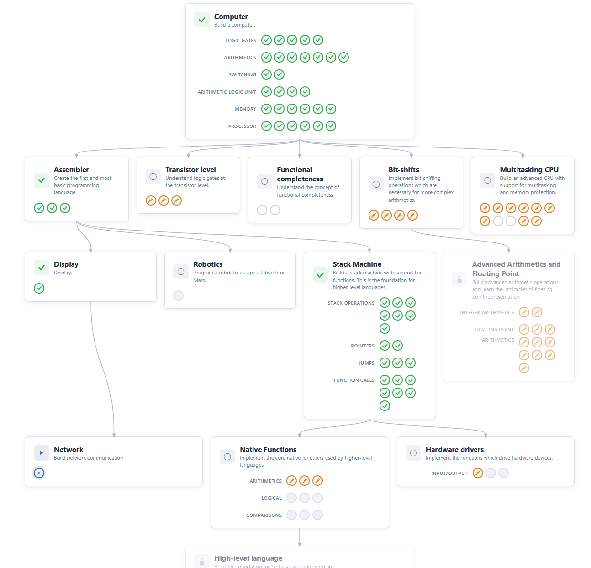

> Решил Кирилл Колосов РИ-340941 ПА-07

Общий вид уровней

т.к. nandgame с момента постановки задачи был обновлен, в точности выполнить поставленное задание не удалось, но по описанию я понял что нужно выполнить следующие модули:

- [Computer](./computer)
- [Assembler](./assembler)
- [Display](./display)
- [Stack Machine](./stack-machine)
- [Компоненты](./components)

Все скриншоты решений и экспорт прогресса
[Google disk](https://drive.google.com/drive/folders/1uZWll7BcgNNzG3mmpx4v4VqPfVqlwaQW?usp=drive_link)
[Github](https://github.com/lenchq/c-programming/tree/master/nandgame)
[Выгрузка nandgame](./nandgame_20261014.json)
