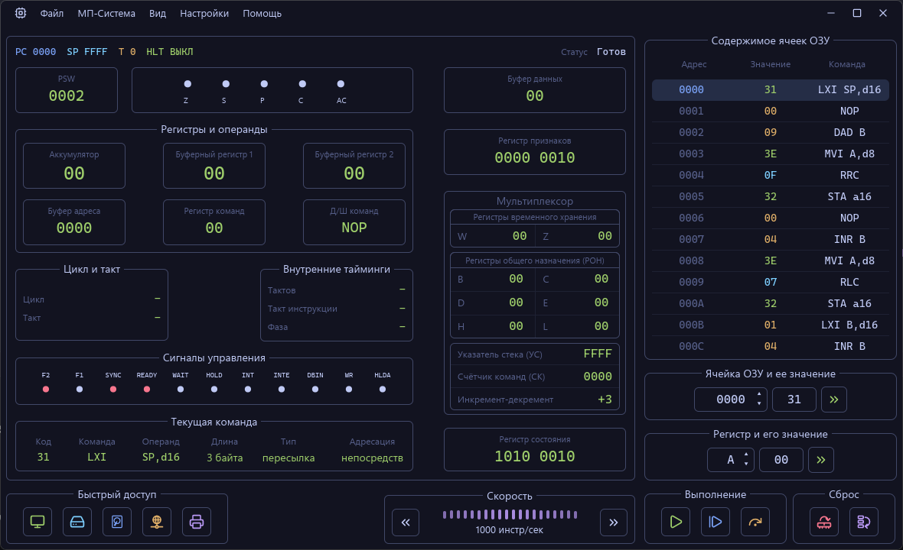
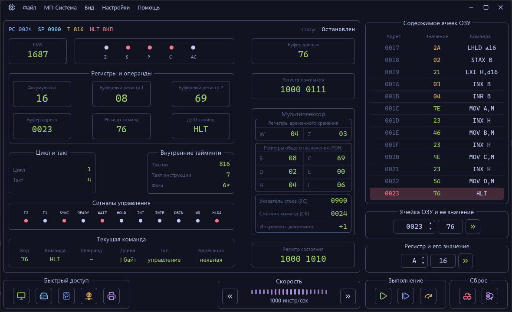

# Задание 1

> Решил Кирилл Колосов РИ-340941 ЛБ-01

## Инструменты
Решение проверялось на эмуляторе процессора КР580ВМ80А (побитово идентичен intel 8080) [KR580](https://github.com/WhoSowSee/KR580/)
При решении использовался компилятор языка ассемблера [zasm](https://github.com/zyantific/zasm)

### Ход решения
Для начала я понял что исходный компилятор CP580.exe не загружается с яндекс диска (ввиду выхода из стоя 3/5 ДЦ яндекса). Поэтому я пошел искать альтернативы и нашел очень новый эмулятор написанный на Rust который выглядит порт того самого эмулятора.

Затем я выяснил что микропроцессор КР580 идентичен процессору i8080. Так как писать программу вручную через заполнение машинного кода в эмуляторе это очень неудобно, я нашел в интернете [комплиятор под i8080 ассемблер](https://github.com/zyantific/zasm) и использовал его. Компилировал файл с кодом и загружал в эмулятор для проверки.

Для справки по командам процессора использовал [статью Эдуарда Пройдаков](https://demin.ws/projects/radio86/info/kr580/i8080.html)

[Исходный код программы](solve.asm)

[листинг программы с комментариями](solve.lst)

### Компиляция
через zasm:
```sh
$ make
```
или
```sh
$ zasm --asm8080 -u -b --reqcolon solve.asm -o solve.bin
```
другой i8080-совместимый ассемблер:
```sh
$ asm80 solve.asm
```

## Результат

Загрузка программы в оперативную память процессора:


Результат выполнения программы:


Для программы использовалить переменные `A = 15` и `B = 7`
По результатам работы программы в регистры `A B C D` были записаны результаты арифметических действий:
```
A = сумма = 0x16 (32_10)
B = сумма = 0x08 (8_10)
C = сумма = 0x69 (105_10)
D = сумма = 0x02 (2_10)
```

Сам [код программы](solve.asm) и [листинг](./solve.lst)
[Слепок ОЗУ для загрузки программы: solve.bin](solve.bin)

## Задача

### Выполнить следующие операции, используя эмулятор микроконтроллера KP580 (каждая задача должна быть реализована в отдельной функции):

- сумма двух чисел
- вычитание двух чисел
- умножение двух чисел
- деление двух чисел

### Условия:

- начальный адрес программы: 0000h;
- начальный адрес функций: 0200h;
- данные для чтения располагаются по адресу 0400h (первое число) и 0401h (второе число);
- результаты выполнения операций хранить по адресам 0403h - 0406h, соответственно;
- программа должна записать значения из регистров A и B в ячейки 0400 и 0401, после чего вызвать каждую функцию и поместить результаты из 0403h - 0406h в регистры A, B, C, D.
